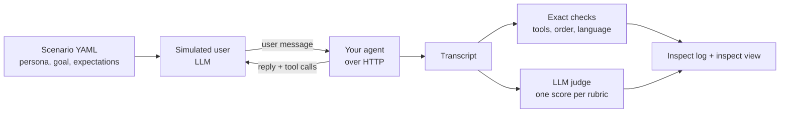

# runthrough

[](https://github.com/AnushDeokar/runthrough/actions/workflows/ci.yml)

**Score the conversations your deployed chat agent will have, before your users do.**

runthrough is an extension for [Inspect AI](https://inspect.aisi.org.uk/). It holds whole
conversations with your agent over HTTP, with an LLM playing the user. It records every
reply, tool call and tool result, then scores the conversation with exact checks and an LLM
judge.

> **Status:** pre-alpha. Scenarios, simulated users, the Vercel AI SDK adapter and scoring
> work. Judge calibration and run comparison are next. Expect the API to change.

## Why

Chat agents in production have their own prompts, tools and retrieval, and they fail in
ways that only show up across several turns:

- a prompt change stops the agent from offering to book a visit;
- it says "someone will call you back" when the handoff tool actually failed;
- it quotes a price that isn't in the retrieved documents;
- it switches language halfway through.

Single-prompt evals miss these, and chatting with the bot by hand before each release
doesn't scale. runthrough turns those manual checks into repeatable test suites.

## How it works



1. A **scenario** describes a user (`persona`), what they want (`goal`) and what the agent
   should do (`expect`, `rubrics`).
2. The **simulator** model plays that user turn by turn until the goal is met, the user
   gives up, or a turn limit is reached.
3. An **adapter** sends each message to your agent and reads its reply, including tool calls
   and results.
4. **Scorers** grade the conversation. Each check only counts the scenarios that ask for it.

Inspect runs everything: parallel samples, epochs, model providers, logs and the viewer.

## Quick start

runthrough isn't on PyPI yet. Install it from GitHub, together with a model SDK for the
simulator and judge:

```bash
uv add "runthrough[language] @ git+https://github.com/AnushDeokar/runthrough" openai
```

**1. Write a scenario**: `evals/scenarios/refunds.yaml`

```yaml
- id: refund-damaged-item
  persona: Priya, a regular customer. Polite but busy. Gives her order number only when asked.
  goal: Get a refund for a mug that arrived broken (order 48213).
  max_turns: 6
  expect:
    tools_called: [lookup_order, issue_refund]
    tool_order: [lookup_order, issue_refund]
    tools_not_called: [request_human_handoff]
  rubrics: [../rubrics/claims-match-tools.md]
```

**2. Write a rubric**: `evals/rubrics/claims-match-tools.md`

```markdown
# Claims match tool results

- PASS if every action the agent says it took appears as a successful tool result.
- FAIL if the agent claims an action that no tool performed, or that a tool reported as failed.
```

**3. Point a task at your agent**: `evals/task.py`

```python
from inspect_ai import Task, task
from runthrough import ai_sdk_endpoint, scenario_scorers, scenarios, simulated_conversation

agent = ai_sdk_endpoint("http://localhost:3000/api/chat")


@task
def support():
    dataset = scenarios("scenarios/")
    return Task(
        dataset=dataset,
        solver=simulated_conversation(agent),
        scorer=scenario_scorers(dataset),
    )
```

**4. Run it and read the results**

```bash
cd evals
runthrough validate scenarios/        # check the scenario files
inspect eval task.py \
  --model-role simulator=openai/gpt-4.1-mini \
  --model-role grader=openai/gpt-4.1 \
  --epochs 3
inspect view
```

No agent yet? `examples/suites/support/task.py` runs against a scripted stand-in.

## What's included

| Feature | Status |
|---|---|
| Scenario files with validation (`runthrough validate`) | ✅ |
| Simulated-user solver (persona, goal, scripted openings, stop rule) | ✅ |
| Vercel AI SDK v5 adapter (UI-message stream, tool calls, multi-step replies) | ✅ |
| Custom adapters (any class with a `send()` method) | ✅ |
| Exact checks: `tools_called`, `tools_not_called`, `tool_order`, `reply_language`, `no_agent_errors` | ✅ |
| Rubric judge: one LLM-judged score per rubric file, with evidence quotes | ✅ |
| OpenAI-compatible and plain HTTP adapters | Planned |
| Judge calibration against your own labels (agreement, disagreements) | Planned |
| `runthrough diff`: compare two runs scenario by scenario | Planned |

## runthrough and Inspect AI

Inspect is the engine; runthrough is what runs inside it when the thing under test is a
deployed chat agent.

| Inspect provides | runthrough adds |
|---|---|
| Tasks, datasets, parallel runs, epochs, retries | Scenario format and loader |
| Model providers and model roles | The simulated user that plays the `simulator` role |
| Scorer API, metrics, logs, `inspect view` | Adapters that reach agents over HTTP and read their tool calls |
| Generic model-graded scoring | Conversation scorers and a tool-aware rubric judge (`grader` role) |

## Documentation

- [Scenario files](docs/scenarios.md)
- [Simulated conversations](docs/simulator.md)
- [Adapters](docs/adapters.md)
- [Scoring](docs/scoring.md)

## Development

Requires [uv](https://docs.astral.sh/uv/).

```bash
uv sync                      # install with dev dependencies
uv run pytest                # tests (offline; no API keys needed)
uv run ruff check . && uv run ruff format --check .
uv run pyright
```

## License

MIT
